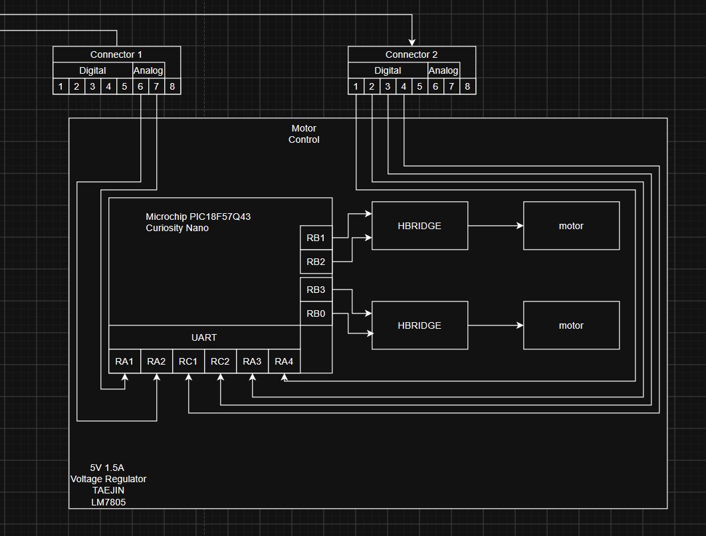

## Overview
A block diagram is an extremely helpful tool in the engineering process as it is a rough representation of the wiring and general idea of a project. It can be used to help pick components as well as build a software plan, and can be used to create prototypes and schematics. It is one of the most fundamental steps during the engineering process as the steps after it build upon it.

