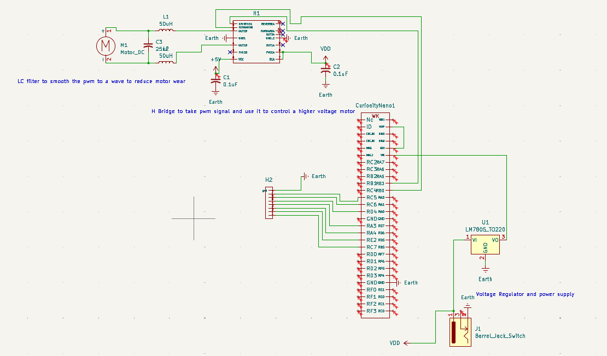

## Overview

This schematic is design to support control of a motor through an H bridge being controlled by a PWM signal from a microcontroller. It uses an LC filter to minimize wear from PWM control by using an analog Voltage. 

{style width:"1110" height:"652;"}
**Figure 01:** Showing the subsystem schematic.

## Resouces

The schematic as a PDF download is available [*here*](Subsystem RAS 304.pdf), and the Zip folder of the project [*here*](Subsystem RAS 304.zip).