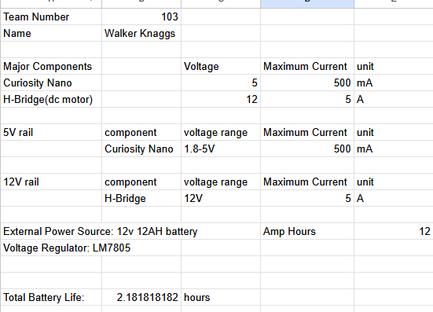

## Overview

I used the datasheets for the parts I used as well as the standard amperage for a 12V DC motor for the H-bridge[cite: 5]. I used this data to determine what voltage regulator to use for the Curiosity Nano and came to the conclusion to use the LM7805 voltage regulator[cite: 5]. I did a power budget because it is important to understand the amount of power used by a system to determine the lifetime it will have when on battery power and the impact it will have on the electrical system if it is plugged in for power.

{style="width:100%; max-width:700px; height:auto;"}

## Conclusions

From the prepared Power Budget, I believe that the lifespan of a battery running a single motor controller and motor will be more than enough for most uses even at maximum power usage. Even though some power will be lost to heat through the H-bridge it is still efficient enough to run for several hours at maximum load.

## Resources

The power budget as a PDF download is available [*here*](Power%20Budget%20-%20Sheet1.pdf), and a Microsoft Excel Sheet [*here*](Power%20Budget.xlsx).